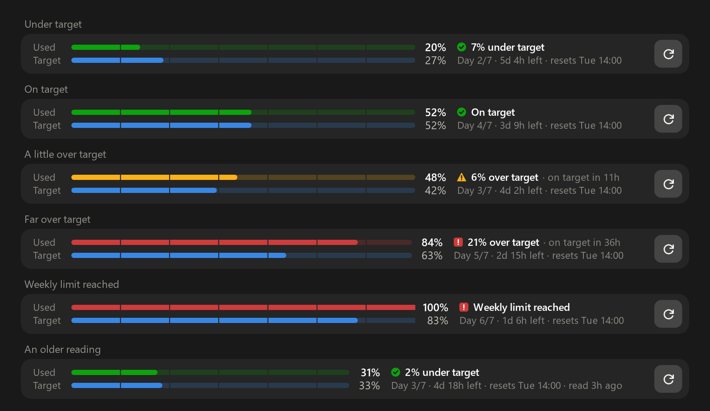
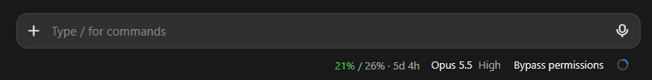
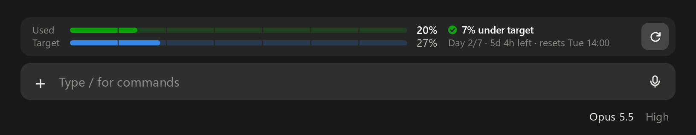
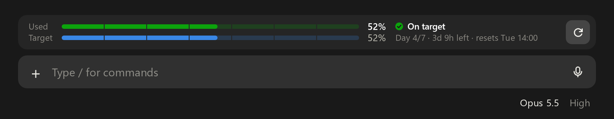
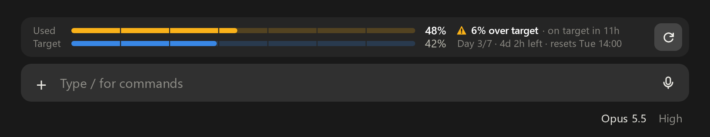
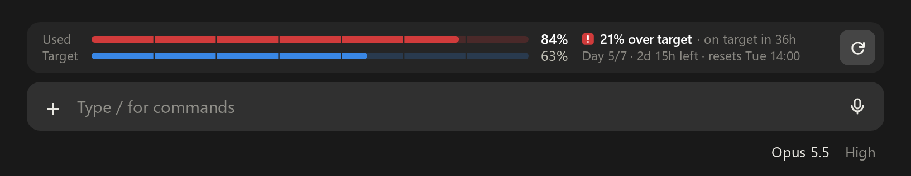
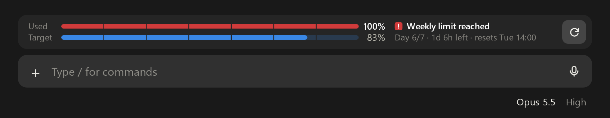
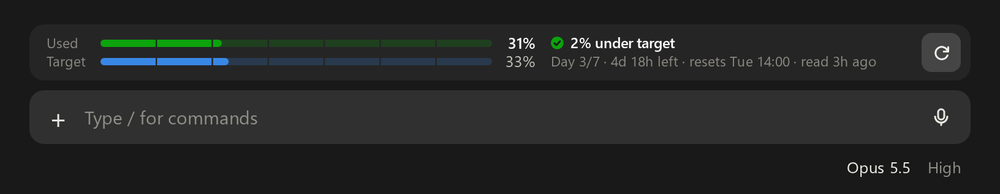

# usage-pace

A mod for Claude Code that shows how much of your weekly Claude subscription limit you have used, next to where an even pace through the week would put you right now. You can see at a glance whether you can keep going at this rate or should slow down.



## What it shows

**Used** is how much of the week's limit you have spent. **Target** is what you would have spent by now if you used the same amount in every hour of the week. The target starts at 0 when your week resets and climbs once an hour, a seventh of the limit per day, until it reaches 100% at the next reset.

Next to the bars it tells you where you stand, and when that changes:

| State | Colour | What it says |
|---|---|---|
| On or under the target | Green ✓ | `7% under target`, `On target` |
| Over the target by less than a day's share | Orange ▲ | `6% over target · on target in 11h`: if you stop now, the target catches up with you in 11 hours |
| Over the target by a day's share (about 14%) or more | Red ■ | `21% over target · on target in 36h` |
| Limit spent | Red ■ | `Weekly limit reached` |

Under the verdict: which day of the week this is, how long until the reset, and when the reset happens. When the figure is more than 30 minutes old it also says how old (`read 3h ago`), because usage in other places has not reached it yet.

### Two views

The mod shows your usage in one of two ways. You pick which, and can change it at any time.

**Label view** (the default): one short line in the footer under the prompt box, ahead of the model name. It takes almost no room.



It reads `21% / 26% · 5d 4h`: **21%** of the week's limit used (coloured green, orange or red as in the table above), **26%** the target for this moment, and **5d 4h** until the week resets.

**Bars view**: the used bar over the target bar in the band above the prompt, with the verdict, the notes on the week and a refresh button at the right. In a terminal the same bars are drawn with text blocks.



### Switching views

Type one of these in any Claude Code session:

| Command | Shows |
|---|---|
| `/usage-pace label` | The label view |
| `/usage-pace bars` | The bars view |
| `/usage-pace switch` | The other view than the one you have now |

The choice is saved, and every other open session switches too within a minute.

### The bars view in every state

| | |
|---|---|
|  |  |
|  |  |
|  |  |

## Requirements

- A Claude subscription (Pro or Max) signed in to Claude Code. Only subscriptions have a weekly limit; with an API key there is nothing to show.
- A recent Claude Code, in the desktop app or the terminal. The mod uses Claude Code's mods (hook modules) and its own prompt-area components.

## Install

In a Claude Code session:

```
/plugin marketplace add lambda5577/usage-pace
/plugin install usage-pace@usage-pace
/reload-plugins
```

Or from a shell:

```bash
claude plugin marketplace add lambda5577/usage-pace
claude plugin install usage-pace@usage-pace --scope user
```

It starts in the label view; `/usage-pace bars` switches to the bars. The figure appears after Claude's next reply, or straight away with `/usage-pace`.

## Commands

| Command | What it does |
|---|---|
| `/usage-pace` | Fetches the latest figure and prints it, for example `Weekly usage, fresh from the app (used / target · time left): 21% / 26% · 5d 4h` |
| `/usage-pace label` | Switches to the label view, under the prompt |
| `/usage-pace bars` | Switches to the bars view, above the prompt |
| `/usage-pace switch` | Switches to the other view |

## Where the figure comes from

- **After each reply**, Claude Code receives your current rate-limit windows with the response. The mod takes the weekly one (`seven_day`) from there.
- **On refresh** (the button, or `/usage-pace`), in the desktop app, it asks the app's own usage tool, the same one behind the app's usage card. This makes no request to a model, so it costs nothing of your limit. In the terminal there is no such tool, so it shows the newest figure any of your sessions has seen.
- **Between sessions**, the newest figure and your chosen view are kept in the mod's store on your machine, so every open session shows the same thing. A figure read later always wins, so an idle session never brings back an old number, also not after your week resets.

Nothing is sent anywhere. The mod has no network access of its own and keeps nothing outside Claude Code's plugin store on your machine.

## Limitations

- **The desktop bars picture is drawn for the dark theme.** In a light theme its white text is hard to read; use the label view there.
- If a reading carries no reset time, the mod shows the used figure alone, with no target.
- The week is counted as seven 24-hour days back from the reset time Anthropic reports.

## Development

The mod is in [`plugins/usage-pace`](plugins/usage-pace):

| File | What it holds |
|---|---|
| `hooks/register.tsx` | Hooks into Claude Code: reads the figures, draws both views, adds `/usage-pace` |
| `hooks/pace.ts` | The pace maths: target, tone, verdict, time to catch up |
| `hooks/art.ts` | The bars picture for the desktop app, as SVG |
| `types/index.d.ts` | The mod's state, shared between sessions |
| `tests/pace.test.tsx` | 25 tests of the maths and of both views in the desktop app and the terminal |

Run the tests with:

```bash
claude plugin test plugins/usage-pace
```

The label view picture is a screenshot of the desktop app. The bars view pictures come from [`tools/screenshots/render.ts`](tools/screenshots/render.ts). It feeds made-up weeks through the mod's own `pace.ts` and `art.ts` and places the result in a copy of the desktop app's prompt area, so they show exactly what the mod draws without reading anyone's real usage. It needs Node 22.18 or newer and Playwright:

```bash
TZ=Europe/Amsterdam PLAYWRIGHT=/path/to/node_modules/playwright-core node tools/screenshots/render.ts
```

## License

[MIT](LICENSE)
